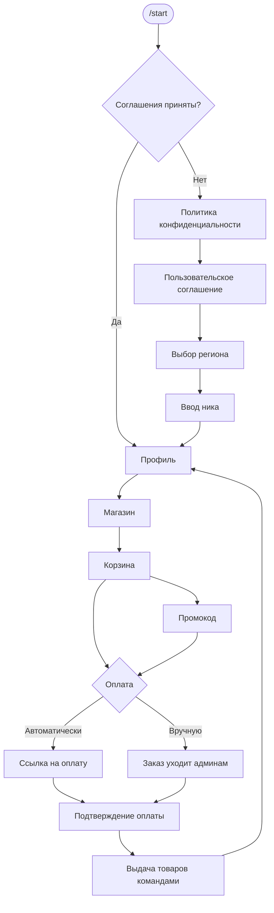

<div align="center">

<h1>Tsfm</h1>

<p><b>TelegramShopForMinecraft</b><br/>
Магазин услуг Minecraft-сервера прямо в Telegram.</p>

<p>
  
  
  
  
  
</p>

<p>
  <a href="#возможности">Возможности</a> ·
  <a href="#как-это-работает">Как это работает</a> ·
  <a href="#быстрый-старт">Быстрый старт</a> ·
  <a href="#как-пользоваться">Как пользоваться</a> ·
  <a href="#настройка">Настройка</a> ·
  <a href="#частые-вопросы">FAQ</a>
</p>

</div>

---

**Tsfm** — это мост между Minecraft-сервером и Telegram. Игрок открывает бота, выбирает товар, собирает корзину и оплачивает заказ. Администратор получает уведомление в Telegram и подтверждает выдачу — либо оплата и выдача происходят автоматически через платёжного провайдера.

Плагин не требует базы данных и внешней панели: всё общение идёт через Telegram-бота, а данные хранятся в JSON внутри папки плагина.

---

## Возможности

| | Возможность |
|---|---|
| 🛒 | **Каталог товаров** — название, цена и команда выдачи настраиваются в `config.yml`. |
| 🧺 | **Корзина** — несколько товаров, количество, удаление позиций, подсчёт итоговой суммы. |
| 🎟 | **Промокоды** — процент скидки, лимит активаций, срок действия. Создаются из конфига или прямо в боте. |
| 💳 | **Два режима оплаты** — вручную (админ подтверждает) или автоматически через API платёжного провайдера. |
| 👤 | **Профиль игрока** — ник, регион, число покупок, активированные промокоды, дата регистрации. |
| 📜 | **История покупок** — все заказы и их статусы. |
| 🌍 | **Регионы** — «Россия» и «Другая страна»; тексты кнопок настраиваются. |
| 📄 | **Соглашения** — политика конфиденциальности и пользовательское соглашение с обязательным принятием. |
| 🛠 | **Админ-панель в Telegram** — активные заказы, аналитика, промокоды, рассылка, блокировки. |
| 📊 | **Аналитика** — заработок за 1, 3, 9, 12 месяцев или за всё время. |
| 🚫 | **Бан и разбан** пользователей бота. |
| 📢 | **Рассылка** сообщения всем зарегистрированным пользователям. |
| 🔔 | **Уведомления админам** о новых заказах и автоподтверждённых оплатах (нужен числовой `id`). |
| 💾 | **JSON-хранилище** — без MySQL и внешних сервисов. |
| 🔌 | **Shade + relocation** — библиотеки Telegram-бота не конфликтуют с другими плагинами. |

---

## Как это работает



**Ручной режим** (`payment.enabled: false`): заказ появляется у всех администраторов, у которых указан числовой `id`. Один из них берёт заказ, при необходимости пишет игроку и подтверждает оплату. После подтверждения плагин выполняет команды выдачи от имени консоли.

**Автоматический режим** (`payment.enabled: true`): плагин создаёт платёж через API провайдера, отправляет игроку ссылку на оплату и периодически проверяет статус. Как только провайдер подтверждает оплату, товары выдаются автоматически.

---

## Требования

| Компонент | Версия |
|---|---|
| Сервер | **Paper 1.16.5** (`api-version: 1.16`) |
| Java | **8+** |
| Telegram | Бот, созданный через [@BotFather](https://t.me/BotFather) |
| Сборка | Maven 3.8+ и JDK 8+ (проверено на JDK 17) |
| База данных | Не требуется |

> На Spigot плагин не тестировался. Для стабильной работы используйте Paper 1.16.5.

---

## Быстрый старт

1. **Создайте бота** в [@BotFather](https://t.me/BotFather) и скопируйте токен.
2. **Соберите плагин** или возьмите готовый `Tsfm.jar`.
3. Положите jar в папку `plugins/` и запустите сервер.
4. Откройте `plugins/Tsfm/config.yml` и заполните минимум:

    ```yaml
    bot:
      token: "1234567890:YOUR_BOT_TOKEN"
      username: "YourShopBot"

    admins:
      - username: "@Admin"
        id: 123456789

    products:
      "diamond-1":
        name: "1 алмаз"
        price: 99
        command: "give {player} diamond 1"
    ```

5. Выполните `/tsfm reload` в консоли или в игре.
6. Напишите боту `/start` — он должен ответить приветствием.

> **Важно:** Telegram-бот не может первым написать пользователю. Администратор должен сам отправить боту `/start`, иначе уведомления о заказах ему не придут.

---

## Установка

### Сборка

```bash
git clone <ссылка-на-репозиторий>
cd Tsfm
mvn clean package
```

Готовый файл появится здесь:

```
target/Tsfm.jar
```

### Установка на сервер

1. Скопируйте `Tsfm.jar` в `plugins/`.
2. Перезапустите сервер.
3. Настройте `plugins/Tsfm/config.yml`.
4. Примените изменения командой `/tsfm reload`.

После первого запуска структура папки выглядит так:

```
plugins/Tsfm/
├── config.yml
└── data/
    ├── players.json
    ├── orders.json
    ├── stats.json
    ├── promos.json
    └── banned.json
```

---

## Как пользоваться

### Для игрока

1. Откройте бота и отправьте `/start`.
2. Прочитайте и примите **Политику конфиденциальности** и **Пользовательское соглашение**.
3. Выберите регион.
4. Введите свой ник на сервере (3–16 символов: буквы, цифры и `_`).
5. Откройте **Магазин**, добавляйте товары в корзину.
6. При желании введите промокод — скидка применится к заказу.
7. Нажмите **Оплатить**:
   - в ручном режиме с игроком свяжется администратор;
   - в автоматическом появится ссылка на оплату.
8. После подтверждения оплаты товары выдаются на сервере автоматически.
9. История покупок и поддержка доступны из профиля.

### Для администратора

1. Добавьте себя в `admins` (username и/или Telegram ID).
2. Отправьте боту `/start` — иначе бот не сможет присылать уведомления.
3. При новом заказе нажмите **Взять заказ**.
4. При необходимости нажмите **Написать игроку** и отправьте сообщение.
5. После получения оплаты нажмите **Подтвердить оплату** — товары выдадутся автоматически.
6. Для отмены используйте **Отменить оплату**.

В админ-панели также доступны:

- 📊 аналитика заработка;
- 🎟 создание, просмотр и удаление промокодов;
- 📢 рассылка всем пользователям;
- ⛔ блокировка и разблокировка пользователей;
- 📦 список активных заказов с постраничной навигацией.

---

## Настройка

### `bot`

```yaml
bot:
  token: "1234567890:YOUR_BOT_TOKEN"
  username: "YourShopBot"
```

- `token` — токен из [@BotFather](https://t.me/BotFather).
- `username` — юзернейм бота без `@`. Используется для отображения.

### `admins`

```yaml
admins:
  - username: "@Admin"
    id: 123456789
```

Можно указать `username`, `id` или оба поля.

- `username` достаточно для доступа к админ-панели.
- `id` обязателен для получения уведомлений о заказах — Telegram не позволяет боту писать по юзернейму.

Рекомендуется указывать оба поля.

### `products`

```yaml
products:
  "diamond-1":
    name: "1 алмаз"
    price: 99
    command: "give {player} diamond 1"

  "vip-30d":
    name: "VIP на 30 дней"
    price: 299
    command: "lp user {player} parent add vip"
```

- Ключ (`diamond-1`) — внутренний идентификатор товара.
- `name` — название, которое видит игрок.
- `price` — цена в рублях.
- `command` — команда выдачи. `{player}` заменяется на ник игрока.
- Команда выполняется **от имени консоли** столько раз, сколько единиц товара в заказе.

### `promocodes`

```yaml
promocodes:
  - name: "HELLO"
    percent: 10
    activations: -1
    duration: "30d 0h 0m"
```

- `name` — название промокода: 2–20 символов, буквы, цифры и `_`.
- `percent` — скидка от 1 до 100.
- `activations` — количество активаций; `-1` — без ограничений.
- `duration` — срок действия в формате `1d 0h 0m`.

Промокоды, созданные через бота, хранятся в `data/promos.json`.

### `payment`

```yaml
payment:
  enabled: false
  sandbox: true
  provider:
    terminal-id: ""
    api-key: ""
    webhook-secret: ""
    api-url: "https://api.example.com/v1/payments"
  callback-url: ""
  success-url: "https://example.com/payment/success"
  fail-url: "https://example.com/payment/fail"
  support-url: "https://example.com/support"
  webhook-port: 8080
```

| Параметр | Назначение |
|---|---|
| `enabled` | `false` — ручная оплата, `true` — автоматическая через API. |
| `sandbox` | Тестовый режим провайдера. |
| `terminal-id` | Идентификатор терминала/магазина у провайдера. |
| `api-key` | Секретный ключ API. |
| `webhook-secret` | Секрет для проверки подписи вебхука. |
| `api-url` | Базовый URL API провайдера. |
| `callback-url` | URL для callback-уведомлений. |
| `success-url` / `fail-url` | Куда вернуть пользователя после оплаты. |
| `support-url` | Ссылка на поддержку. |
| `webhook-port` | Порт локального webhook-сервера. |

Если `enabled: false`, все платёжные ключи можно оставить пустыми.

### `agreements`

```yaml
agreements:
  enabled: true
  privacy:
    url: "https://example.com/privacy"
    text: "Политика конфиденциальности"
  terms:
    url: "https://example.com/terms"
    text: "Пользовательское соглашение"
```

Пока игрок не нажмёт «Я прочитал» на обоих документах, покупка недоступна. При `enabled: false` соглашения пропускаются.

### `support`

```yaml
support:
  url: "https://t.me/your_support"
  text: "По любым вопросам покупки пишите в чат поддержки!"
```

Если `url` пустой, кнопка-ссылка не показывается.

### `messages` и `buttons`

Все тексты бота и подписи кнопок находятся в отдельных секциях `messages` и `buttons`. Поддерживаются плейсхолдеры:

```
{nick} {country} {purchases} {promos} {date} {name} {price}
{quantity} {sum} {total} {items} {products} {cart} {order}
{promo} {percent} {saved} {text} {count} {period} {amount}
{username} {region} {admin} {page} {pages} {left} {list}
{duration} {activations}
```

Меняйте тексты под свой сервер — код плагина трогать не нужно.

---

## Команды и права

| Команда | Алиасы | Право | Описание |
|---|---|---|---|
| `/tsfm reload` | `/shopbot reload` | `tsfm.reload` | Перезагрузить конфиг, данные, платёжный сервис и бота. |

Право `tsfm.reload` по умолчанию доступно операторам (`default: op`).

Вся остальная работа происходит внутри Telegram-бота — отдельных команд для игроков нет.

---

## Админ-панель

Админ-панель открывается из профиля пользователя, указанного в `admins`.

| Кнопка | Что делает |
|---|---|
| 📊 **Аналитика заказов** | Сумма и количество подтверждённых заказов за период. |
| 🎟 **Создать промокод** | Пошаговое создание: название → процент → активации → срок. |
| 📋 **Действующие промокоды** | Список активных промокодов и удаление. |
| 📢 **Сообщение всем** | Рассылка текста всем зарегистрированным пользователям. |
| ⛔ **Блокировка пользователя** | Бан пользователя бота по username. |
| 🚫 **Лист заблокированных** | Список банов и разблокировка. |
| 📦 **Заказы** | Активные заказы, взятие в работу, сообщение игроку, подтверждение и отмена. |

---

## Платёжный провайдер

Плагин совместим с провайдерами, которые принимают JSON-запросы и возвращают ссылку на оплату. Контракт описан ниже — если ваш провайдер работает иначе, адаптируйте `PaymentService`.

<details>
<summary><b>Создание платежа</b></summary>

**Запрос**

```http
POST {api-url}
X-API-Key: {api-key}
Content-Type: application/json
X-Test-Mode: true   # только при sandbox: true
```

```json
{
  "terminal_id": "your-terminal-id",
  "amount": "99.00",
  "payment_currency": "RUB",
  "order_id": "123456",
  "test": true,
  "callback_url": "https://example.com/callback",
  "success_url": "https://example.com/success",
  "fail_url": "https://example.com/fail",
  "support_url": "https://example.com/support"
}
```

**Ответ**

```json
{
  "pay_url": "https://provider.example/pay/...",
  "payment_id": "pay_123",
  "environment": "sandbox"
}
```

Обязательное поле — `pay_url`. Без него платёж считается неудачным.

</details>

<details>
<summary><b>Проверка статуса</b></summary>

**Запрос**

```http
GET {api-url}/{payment_id}
X-API-Key: {api-key}
X-Test-Mode: true   # только при sandbox: true
```

**Ответ**

```json
{
  "status": "paid"
}
```

Поддерживаемые статусы:

| Статус | Результат |
|---|---|
| `paid`, `succeeded` | Заказ подтверждён, товары выданы. |
| `failed`, `cancelled` | Заказ отменён. |

Статус проверяется каждые 10 секунд. Если оплата не подтвердилась за 30 минут, заказ автоматически отменяется.

</details>

> `WebhookServer` — заготовка для провайдеров, которые поддерживают вебхуки. В текущей версии статус оплаты опрашивается через API.

---

## Данные и резервные копии

Все данные лежат в `plugins/Tsfm/data/`:

| Файл | Содержимое |
|---|---|
| `players.json` | Профили пользователей бота. |
| `orders.json` | Активные и обрабатываемые заказы. |
| `stats.json` | Подтверждённые заказы для аналитики. |
| `promos.json` | Промокоды, созданные через бота. |
| `banned.json` | Заблокированные пользователи. |

Файлы записываются в читаемом JSON. Для резервной копии достаточно остановить сервер и скопировать папку `plugins/Tsfm`.

> Плагин рассчитан на **один сервер**. Общей базы для сети серверов нет.

---

## Сборка из исходников

```bash
mvn clean package
```

- Итоговый артефакт: `target/Tsfm.jar`.
- Зависимости Telegram-бота шейдятся и relocate-ятся в `Al3xPay.Tsfm.libs.*`.
- Paper API и SLF4J подключены как `provided` и в jar не попадают.

---

## Структура проекта

```
src/main/java/Al3xPay/Tsfm/
├── Tsfm.java                 # точка входа, команды, запуск бота
├── bot/
│   ├── ShopBot.java          # обёртка над TelegramLongPollingBot
│   └── Flow.java             # вся логика диалогов и кнопок
├── config/
│   └── ShopConfig.java       # чтение config.yml
├── data/
│   ├── DataManager.java      # загрузка и сохранение JSON
│   ├── Order.java
│   ├── OrderItem.java
│   ├── PlayerData.java
│   ├── PromoCode.java
│   ├── PurchaseRecord.java
│   └── BannedUser.java
└── payment/
    ├── PaymentService.java   # создание платежа и проверка статуса
    └── WebhookServer.java    # заготовка для приёма вебхуков
```

---

## Безопасность

- 🔑 **Не публикуйте `config.yml` с реальным токеном и ключами API.** Добавьте файл в `.gitignore`, если храните его в репозитории.
- ♻️ Если токен или ключи попали в git/архив — перевыпустите их. Токен бота меняется в [@BotFather](https://t.me/BotFather).
- 🔒 Ограничьте доступ к папке `plugins/Tsfm` на сервере.
- 🌐 Используйте HTTPS для `api-url` и callback-адресов.
- 👤 Выдавайте доступ к админ-панели только доверенным Telegram-аккаунтам.
- 💾 Делайте резервные копии `plugins/Tsfm/data/` перед обновлениями.
- ⚠️ Не используйте `/reload` сервера — для плагина есть `/tsfm reload`.

---

## Частые вопросы

<details>
<summary><b>Бот не отвечает на /start</b></summary>

Проверьте:

1. Токен в `bot.token` скопирован полностью.
2. Бот действительно запущен — в консоли есть сообщение о подключении к Telegram.
3. Сервер имеет доступ в интернет.
4. После изменения конфига выполнен `/tsfm reload`.

</details>

<details>
<summary><b>Админу не приходят новые заказы</b></summary>

1. Проверьте `admins` — username или числовой `id`.
2. Администратор должен сам отправить боту `/start`.
3. После изменения списка админов выполните `/tsfm reload`.

</details>

<details>
<summary><b>Кнопка «Оплатить» не создаёт платёж</b></summary>

1. Убедитесь, что `payment.enabled: true`.
2. Заполнены `terminal-id`, `api-key` и `api-url`.
3. Провайдер доступен с сервера.
4. Посмотрите консоль — там будут ошибки `[Payment]` с HTTP-кодом и телом ответа.

</details>

<details>
<summary><b>Товар не выдался после оплаты</b></summary>

1. Проверьте `command` у товара в `config.yml`.
2. Убедитесь, что команда работает от имени консоли.
3. Проверьте, что в команде используется `{player}`.
4. Посмотрите предупреждения в консоли — плагин пишет, если команда не настроена.

</details>

<details>
<summary><b>Русский текст в конфиге отображается кракозябрами</b></summary>

Сохраняйте `config.yml` в **UTF-8 без BOM**. Большинство редакторов делают это по умолчанию, но некоторые меняют кодировку при сохранении.

</details>

<details>
<summary><b>Можно ли использовать MySQL или сеть серверов?</b></summary>

В текущей версии нет. Хранилище — JSON-файлы, плагин рассчитан на один сервер. Для сети потребуется доработка `DataManager`.

</details>

<details>
<summary><b>Поддерживается ли Folia?</b></summary>

Нет. Плагин использует обычный Bukkit-шедулер и рассчитан на Paper.

</details>

<details>
<summary><b>Как изменить валюту?</b></summary>

Символ валюты задаётся в текстах `messages` (например, `р`). Код валюты для платёжного провайдера (`RUB`) задаётся в `PaymentService` — при необходимости замените его там.

</details>

---

## Ограничения

- Только **один сервер** и JSON-хранилище.
- Нет поддержки Folia.
- Нет веб-панели — всё управление в Telegram.
- Автоматическая оплата работает через периодическую проверку статуса (10 секунд).
- Telegram-бот не может первым начать диалог с пользователем.
- Валюта и набор регионов зашиты в код; тексты — в конфиге.

---

